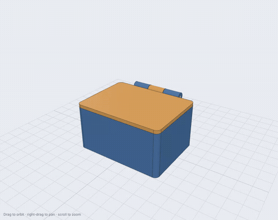

# AI CAD

AI-driven CAD for things you make on real machines: 3D printers, CNC routers, UV printers and fiber lasers.

You describe a part to Claude, Claude writes it as a parametric [build123d](https://github.com/gumyr/build123d) model through this project's MCP server, and a browser viewer shows the result live: explode the assembly, play its joints, tweak parameters, and download files for the machine.



## Quick start (macOS or Linux)

```bash
git clone https://github.com/tmcanally/ai-cad.git
cd ai-cad
./setup.sh
```

`setup.sh` installs [uv](https://docs.astral.sh/uv/) if needed, puts Python 3.12 and all dependencies in `./.venv`, runs the tests, exports the demo box to `exports/`, and opens the viewer at http://127.0.0.1:8765. Use `./setup.sh --no-serve` to skip opening the viewer.

It needs about **2 GB of free disk**, mostly for the OpenCascade kernel. Nothing is installed system-wide; delete the folder (and run `uv cache clean`) to remove it all.

## Using it with Claude

Register the MCP server once.

Claude Code:

```bash
claude mcp add aicad -- uv --directory /path/to/ai-cad run aicad mcp
```

Claude Desktop: add this under `"mcpServers"` in `~/Library/Application Support/Claude/claude_desktop_config.json` (use the full path to `uv`, which `which uv` prints), then restart Claude:

```json
"aicad": { "command": "/Users/you/.local/bin/uv", "args": ["--directory", "/path/to/ai-cad", "run", "aicad", "mcp"] }
```

Keep the viewer open (`uv run aicad serve --open`) and ask, for example, *"Make a phone stand 80 mm wide with a cable slot, then export it for printing."* With **Follow Claude** ticked, the viewer switches to each design Claude builds.

| MCP tool | What it does |
|---|---|
| `list_designs` | Designs and their parameters |
| `read_design_source` | The Python for a design, to learn from or modify |
| `write_design` | Save a new design to `designs/<name>.py` with a note on what changed, build it, show it in the viewer, and return errors and parameter-check warnings |
| `set_params` | Change parameter values and keep them (recorded as a version) |
| `build_design` | Preview other parameter values without saving them; returns sizes, volumes and validity |
| `undo_design` | Step back one version; repeat to keep going back |
| `list_versions` / `restore_version` | See a design's history and bring back any version |
| `export_stl` | One STL per part, into `exports/<name>/` |
| `prepare_print` | Print-ready plates for the AnkerMake M5: orients and arranges the printed parts, picks supports, brim and infill, and writes a `.3mf` and sliced `.gcode` per plate |

## Command line

```bash
uv run aicad list                                     # designs
uv run aicad serve --open                             # viewer
uv run aicad export hinged_box --param width=100      # STLs into exports/hinged_box/
uv run aicad print roman_shade --param print_pieces=1 # M5 plates into exports/roman_shade/ankermake_m5/
uv run pytest                                         # tests
```

## The viewer

- **Explode**: slides each part along its own explode offset.
- **Motion**: one slider per motion, plus **Play**. Hinges turn and sliders slide; motions that change shape (like fabric folding) rebuild the design along the way, and Play fetches those frames first.
- **Parts**: show or hide each part, download its STL, or download all of them as a zip.
- **Print**: arranges the printed parts on AnkerMake M5 plates and slices them. Shows each plate's layout, time and filament, with G-code and 3MF downloads. Change any part's orientation or supports and prepare again.
- **Parameters**: change a number and the model rebuilds straight away. **Save values** keeps them; **Revert** goes back to the saved ones.
- **History**: every change, from Claude or from you, is a numbered version with a note. **Undo** steps back, and **Restore** brings back any version.

three.js is vendored in `src/aicad/viewer/vendor/`, so the viewer works offline.

## Printing on the AnkerMake M5

`aicad print <design>` (or `prepare_print` from Claude, or **Print** in the viewer) turns a design into files you can print:

1. **Which parts.** Every part except bought ones. A material starting with "Buy", or naming metal, wood, fabric or filament pins, is left out. A design can say so explicitly with `Part(printable=False)`.
2. **Which way up.** Each part is tried on all six sides. The pick has the least overhang (horizontal holes up to 10 mm and short bridges don't count), then the steadiest footprint. Parts too long to lie straight go across the bed's diagonal.
3. **Settings.** Supports go on only where real overhangs remain. Tall, thin or small-footprint parts get a 5 mm brim. Infill is 20% with 3 walls and 0.2 mm layers. The filament comes from the part's material (PLA+ if none is given).
4. **Plates.** Parts are packed onto as few 235 × 235 mm plates as possible, one filament per plate. A plate the slicer says would take more than 24 hours is split in two.
5. **Files.** In `exports/<design>/ankermake_m5/`: a `.3mf` per plate that opens in AnkerMake Studio, PrusaSlicer or OrcaSlicer with everything in place and each part's settings attached, a sliced `.gcode` per plate, `PRINT-LIST.md`, and `plan.json`.

Every choice can be overridden:

```bash
uv run aicad print roman_shade --param print_pieces=1 \
    --set filament=PETG --set infill=30 \
    --part headrail_1.orientation=back --part headrail_1.supports=on
```

Job settings: `filament`, `layer_height`, `spacing`, `max_plate_hours`. Per-part settings (with `--set` they apply to every part): `orientation` (`auto`, `bottom`, `top`, `front`, `back`, `left`, `right`), `supports` (`auto`/`on`/`off`), `infill`, `walls`, `brim`, `copies`. A design can set its own per-part defaults with `Part(print_settings={...})`.

**Slicing needs PrusaSlicer** (free; AnkerMake Studio is built on it, but its command line isn't documented). Install it with `brew install --cask prusaslicer` on a Mac, or `sudo apt install prusa-slicer` on Linux. AI CAD finds it in `/Applications` or on your PATH, or set `AICAD_SLICER` to the binary. Without it you still get the `.3mf` plates: open one in AnkerMake Studio and press Slice. The M5 profile is `src/aicad/printers/ankermake_m5.ini`, based on AnkerMake's own PrusaSlicer profile.

## Describe, look, refine

1. Tell Claude what you want: *"A box for an ESP32 board, 55 × 28 mm, screw-down lid, USB-C hole in one end, vents in the lid."* Claude writes a design where every size is a named parameter, and the viewer shows it.
2. Change sizes by saying so (*"10 mm taller, fit a 70 mm board"*) or by typing in the Parameters panel and pressing **Save values**.
3. Change the shape by saying so (*"add tabs to screw it to a wall"*). Claude edits the design, adds parameters for anything new, and your saved values carry over.
4. *"Undo that"* or the **Undo** button steps back.

History is kept in `designs/.history/<name>/`, and saved values in `designs/<name>.params.json`, which override the defaults written in the design file.

## Writing a design

A design is one Python file in `designs/` (yours) or `src/aicad/models/` (built-in examples). It defines `build(**params)` and returns a `Design`:

```python
from build123d import *
from aicad.design import Design, Motion, Param, Part

TITLE = "Phone stand"
PARAMS = {"width": Param(70, 40, 120, description="Overall width")}

def build(width=70) -> Design:
    body = Box(width, 50, 5)
    return Design(name="phone_stand", parts=[Part("body", body, color="#4f7cac", material="PLA")])
```

Units are millimetres and Z is up. For moving parts, use build123d joints: put a `RevoluteJoint` on the parent and a `RigidJoint` on the child, place the child with `joint.connect_to(child_joint, angle=0)`, and add `Motion.from_revolute_joint(...)` so the viewer can animate it. Sliding parts use a `LinearJoint` and `Motion.from_linear_joint(...)`. When a motion changes shape rather than just moving parts, make the position a parameter and add `Motion.from_param("name", "param", (lo, hi))`: the [Roman shade](src/aicad/models/roman_shade.py) does this for its two rails, and its fabric folds are worked out by `build()` at every position. The [hinged box](src/aicad/models/hinged_box.py) shows the joint pattern, and its tests check that the viewer's animation matches the CAD joint and that the lid clears the base from 0° to 110°.

## Layout

```
setup.sh                 one-command setup
src/aicad/
  design.py              Design / Part / Motion / Param, tessellation for the viewer
  registry.py            finds and builds designs (reloads files when they change)
  export.py              STL export (DXF/SVG next)
  printing.py            print prep: orientation, supports, plate packing, 3MF, slicing
  printers/              slicer profiles (AnkerMake M5)
  history.py             versions, undo and saved parameter values
  checks.py              parameter check run on every design Claude writes
  server.py              FastAPI app: viewer + JSON API
  mcp_server.py          MCP server for Claude
  cli.py                 `aicad` command
  models/hinged_box.py   demo assembly (hinge joint)
  models/roman_shade.py  top-down/bottom-up Roman shade, spring or motorized (motions that rebuild)
  viewer/                three.js viewer
designs/                 designs you or Claude create
tests/
```

## Roadmap

1. ~~Thin slice: build123d core, MCP server, viewer with explode and joint animation, STL export.~~
2. **Laser and CNC**: DXF/SVG export of flat parts and sections, for the MOPA fiber laser and the FluidNC router.
3. **CNC toolpaths**: 2.5D pocket and profile G-code for FluidNC.
4. **UV printer**: artwork placement on 3D surfaces, including pre-distortion for rotary printing.
5. ~~**AnkerMake M5 printing**: orientation, supports, plate packing, 3MF and sliced G-code.~~ More printer profiles (Marlin machines) next.
6. More joint types (sliders, gears) and collision checks over a motion's whole range.
